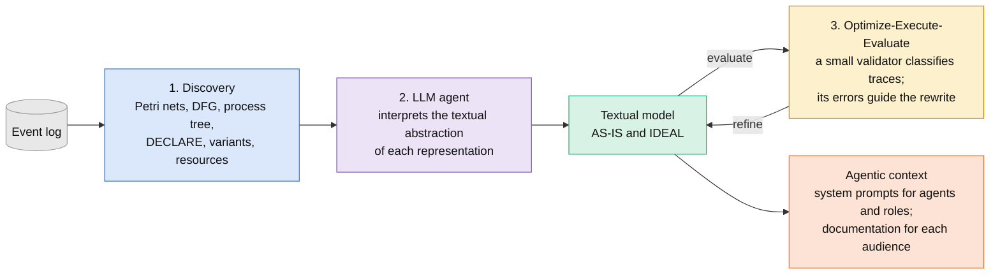
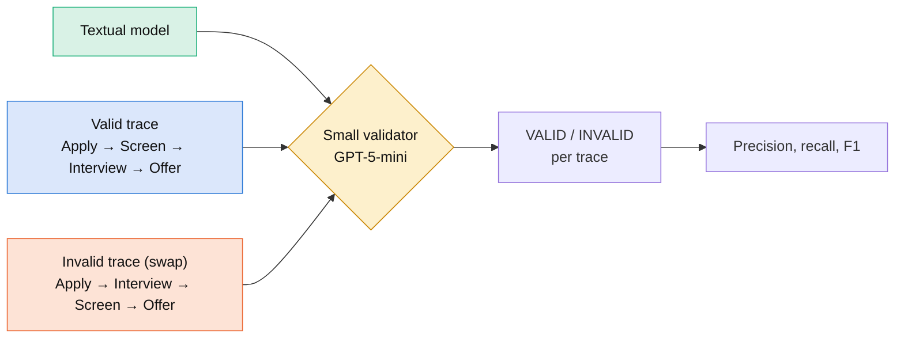
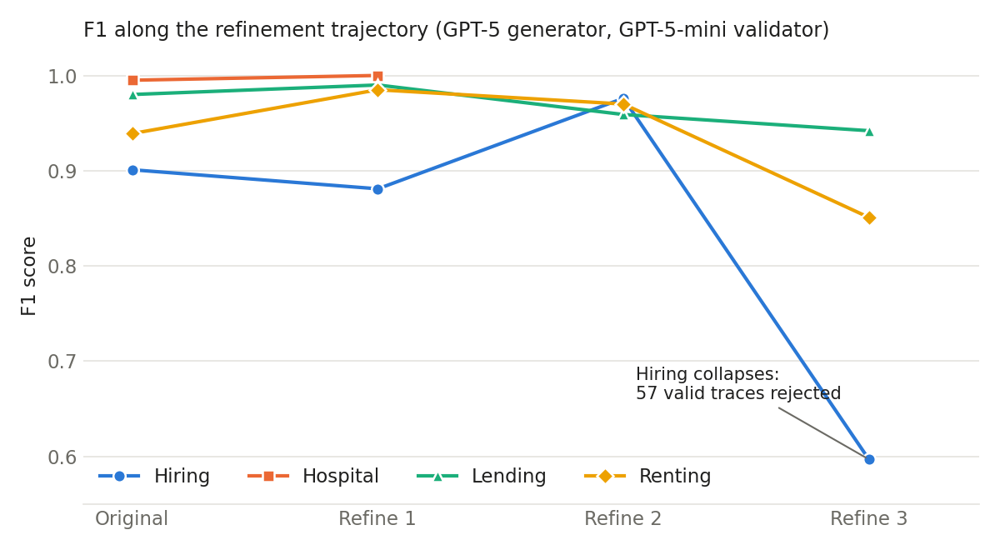
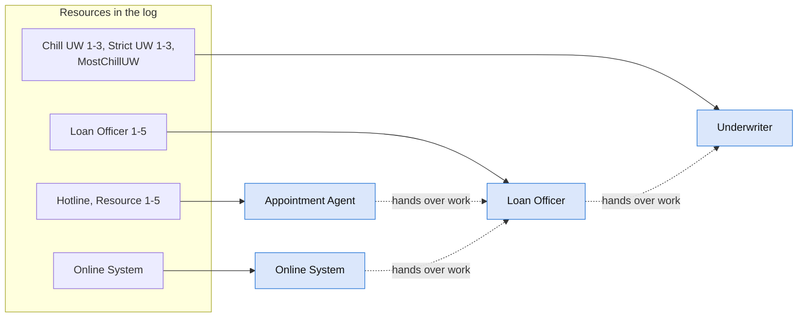
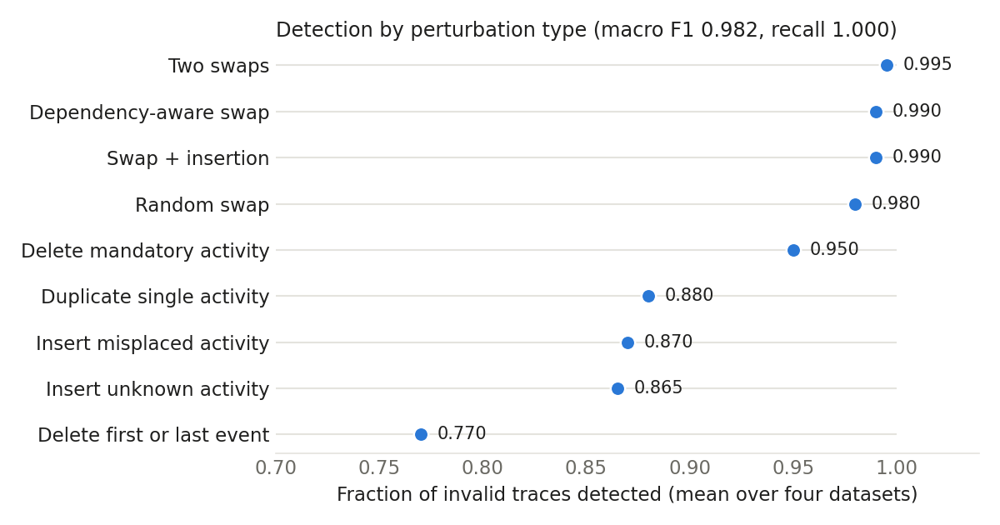

<p align="center">
  
  &nbsp;&nbsp;&nbsp;&nbsp;&nbsp;&nbsp;
  
</p>

<h1 align="center">Agentic Process Mining (APM)</h1>

<p align="center"><b>From Processes to Agents: Textual Models for Converting Process Logs into Agentic Systems</b></p>

<p align="center">
Marco Sánchez Sorondo<sup>1,2</sup> · Claudio E. Righetti<sup>1</sup> · Paulo Veiga<sup>1</sup><br>
<sup>1</sup>Departamento de Computación, Facultad de Ciencias Exactas y Naturales, Universidad de Buenos Aires, Argentina<br>
<sup>2</sup>Universidad Austral, Argentina
</p>

<p align="center">RISE AI Summit 2026 · Santiago, Chile · <a href="docs/poster_rise2026.pdf">Poster (PDF)</a></p>

This repository contains the code and results of the work, which extends the Licenciatura thesis of the first author at the Universidad de Buenos Aires.

---

## In brief

APM takes as input an event log, the record of executed activities that an information system keeps for a process, and generates a **textual process model**: a natural-language description of the behavior recorded in the log, including main flows, exceptions, business rules and constraints. APM requires such a log; it can describe only the behavior the log contains.

The same document serves two readers:

- **People** (executives, analysts, developers, auditors) who need to understand the process.
- **AI agents** that need to operate within it. The textual model becomes part of the agent's instructions.

We evaluated whether these documents capture the behavior recorded in the log. A small AI model, given only the textual model, decides whether each sequence of events is valid or invalid for that process. With GPT-5 as the generator, the small model reaches a mean F1 of 0.954 on four processes, and 0.988 after automatic refinement of the document. On a similar task (classifying traces with swapped activities as valid or anomalous), Rebmann et al. (2024) report that open 7–8B language models prompted with a few examples and no explicit process context perform comparably to a random classifier (macro F1 0.49–0.51); fine-tuning raises them to 0.79.

## The problem

Agentic systems based on Large Language Models (LLMs) promise productivity gains, but designing, implementing, evaluating and maintaining them requires specialists in both business logic and agentic software. Processes encode tacit rules, exceptions and heuristics that are rarely documented, and translating them into instructions for an agent, and keeping those instructions up to date, depends on those specialists.

Where event logs exist, Process Mining discovers formal models of how the process was executed. Its outputs (Petri nets, directly-follows graphs, process trees, declarative constraints) are precise but require specialist knowledge to read, and they are not designed as context for LLM-based agents.

APM converts these formal outputs into text that people and LLM-based agents can use.

## How APM works



1. **Discovery.** PM4Py discovers several representations of the same process from the log: Petri nets (Inductive, Alpha, Heuristics, ILP), directly-follows graph, process tree, heuristics net, DECLARE constraints, log skeleton, trace variants and log attributes. Each representation shows a different aspect of the process.
2. **Interpretation and generation.** An LLM agent reads the textual abstraction of each representation (`pm4py.llm`) and writes an integrated textual model. It produces an AS-IS model (how the process runs) and an IDEAL model (how it should run).
3. **Optimize, execute, evaluate.** A small validator uses the textual model to classify traces. The agent receives the traces the validator got wrong and rewrites the model to correct them. These errors play the role of *textual gradients* (Yuksekgonul et al., TextGrad). The cycle keeps the best model of the whole trajectory, not the last one.

Discovery, generation and optimization run without human intervention.

## How we measure quality

The **Model Fidelity Benchmark** checks whether a separate model, given only the textual model, can distinguish valid traces from invalid ones.

- A small reasoning model (GPT-5-mini) receives the textual model as its only context.
- It classifies each trace as VALID or INVALID, one trace per request, answering with one word.
- Valid traces come from the log. Invalid traces come from swapping two events of a valid trace (for example, *Apply → Interview → Screen → Offer* instead of *Apply → Screen → Interview → Offer*).
- Each dataset uses 100 valid and 100 invalid traces. A random classifier scores F1 = 0.50.



We chose a small validator on purpose. It works as a clarity test: the process knowledge must reside in the textual model, not in the validator's own knowledge.

The data are the four simulated event logs of Pohl et al. (2023): **Hiring**, **Hospital**, **Lending** and **Renting**.

## Results

### Generation with different LLMs

| Generator + validator | Hiring | Hospital | Lending | Renting | Mean |
|---|---|---|---|---|---|
| **GPT-5** + GPT-5-mini | 0.901 | 0.995 | 0.980 | 0.939 | **0.954** |
| Grok 4.1 + GPT-5-mini | 0.787 | 0.985 | 1.000 | 0.976 | 0.937 |
| Claude Sonnet 4.5 + GPT-5-mini | 0.791 | 0.995 | 0.980 | 0.976 | 0.936 |
| DeepSeek V3.2 + GPT-5-mini | 0.833 | 0.985 | 0.922 | 0.952 | 0.923 |
| GPT-5-mini + GPT-5-mini | 0.775 | 0.985 | 0.990 | 0.935 | 0.921 |
| GPT-5-mini + GPT-5-nano | 0.885 | 0.980 | 0.957 | 0.923 | 0.936 |

The textual models tend to be permissive: recall is perfect and the errors are false positives (invalid traces accepted as valid). With GPT-5 as generator, the validator made 40 errors in 800 classifications. The GPT-5-mini + GPT-5-nano pair reaches 98% of the best F1 at about 2% of the cost.

### Optimization and semantic overfitting

| | Hiring | Hospital | Lending | Renting |
|---|---|---|---|---|
| Original model F1 | 0.901 | 0.995 | 0.980 | 0.939 |
| Best model F1 | **0.976** | **1.000** | **0.990** | **0.985** |
| Optimal iteration | Refine 2 | Refine 1 | Refine 1 | Refine 1 |

<p align="center"></p>

Mean F1 rises from 0.954 to 0.988, and false positives drop by 80% (from 40 to 8). Refinement does not improve the model at every step. Each iteration adds constraints; in the third refinement of Hiring the model rejects 57% of the valid traces. We call this **semantic overfitting**: overfitting in the space of textual descriptions instead of in parameter space. In practice, you have to monitor both false positives and false negatives and select the best model for each process.

### Adaptive explanations

We rewrote the optimized model for two contrasting audiences and evaluated each version with the same benchmark.

| Variant | F1 | Recall | FP |
|---|---|---|---|
| Baseline | 0.953 | 1.000 | 10.5 |
| Executives | 0.969 | 1.000 | 7.0 |
| Children | 0.969 | 1.000 | 6.5 |

Both adaptations keep the fidelity of the original. In Hiring, the version written for children improves F1 from 0.873 to 0.943: our interpretation is that explaining the process in simple terms led the adapter to remove ambiguous formulations.

### Decomposition by role

An agent groups individual resources into logical roles (for example, *Loan Officer 1–5* into *Loan Officer*) and writes one model per role: its activities, its decisions, and from whom it receives work and to whom it hands it over.



*Lending: 19 resources grouped into 4 roles. Each role gets its own textual model, usable as an agent's system prompt.*

| | Resources | Roles | F1 full model | F1 by roles | ΔF1 |
|---|---|---|---|---|---|
| Hiring | 8 | 6 | 0.769 | 0.766 | −0.003 |
| Hospital | 7 | 2 | 0.990 | 0.947 | −0.043 |
| Lending | 19 | 4 | 0.990 | 0.990 | +0.000 |
| Renting | 15 | 5 | 0.976 | 0.935 | −0.041 |
| Mean | | | 0.931 | 0.910 | −0.021 |

Concatenated, the role models preserve 97.9% of the full model's F1 on average. Each role model can serve as the system prompt of an agent in a multi-agent system, and the handover-of-work network describes how those agents interact.

### Extended benchmark: nine perturbation types

We extended the benchmark beyond event swapping to nine perturbation types, with 100 valid and 50 invalid traces per type and dataset. The benchmark discards any perturbed trace that matches a variant observed in the log. With the same representations and models (GPT-5 + GPT-5-mini, model without optimization), macro F1 is 0.982 and recall stays at 1.000.

| Perturbation | Detected | Perturbation | Detected |
|---|---|---|---|
| Random swap | 0.980 | Insert unknown activity | 0.865 |
| Dependency-aware swap | 0.990 | Insert misplaced activity | 0.870 |
| Two swaps | 0.995 | Duplicate single activity | 0.880 |
| Swap + insertion | 0.990 | Delete first or last event | 0.770 |
| Delete mandatory activity | 0.950 | | |

<p align="center"></p>

*Fraction of invalid traces detected, mean over the four datasets.* The validator detects between 98.0% and 99.5% of the swap-based perturbations; insertions (86.5–88.0%) and the deletion of the first or last event (77.0%) are the hardest cases.

## What the textual model is for

- **Documentation** for executives, analysts, developers and auditors, derived from the behavior recorded in the log.
- **Context for agents**: the textual model, or one model per role, goes into the agent's system prompt.
- **Low-cost validation**: in our experiments a small model with the textual model as context classified traces with high F1, which makes on-premise validation and continuous conformance monitoring feasible.

The textual model is **part of the automation's code**. Changing it changes the agent's behavior, as changing source code changes a program. Treat it like code: version it, review it, and test it, with the benchmark as the test suite. The developer still has to provide what the textual model does not: tools that act on real systems, the decision of which activities an agent may execute and which ones stay with people, integrations, and human supervision points.

## Limitations and responsible use

- APM depends on the availability and quality of event logs. Many organizations log their processes partially or not at all, and the textual model cannot describe behavior that the log does not record.
- The four logs are simulated and use descriptive activity names ("Approve credit application" rather than "ACT_07"). Real logs with cryptic names, missing events or noise will lower performance.
- Classification is binary. Conformance checking in practice often needs graded answers.
- We evaluated a single validator model; other small models may behave differently.
- Textual abstractions sent to external APIs may contain sensitive business information. On-premise models or anonymization mitigate this.

Agentic systems built with APM should not decide without human supervision when the decision affects people (hiring, loan approval), has legal or regulatory implications, or carries risk of harm. In those cases we recommend that the system propose, a person approve, and the reasoning stay documented for review.

## Future work

**Local models to preserve privacy and safety.** In the current experiments the generator and the validator run on external APIs, so event logs and textual models leave the organization. The next step is to run the whole pipeline on open-weight models deployed on-premise, so that business data does not leave the organization's infrastructure. Because a small validator already works with the textual model as context, the validation side fits on modest hardware; the open question is how small a local generator can be while keeping fidelity.

**Fine-tuning the generator.** The textual model is the prompt of the validator, so improving the generator is a form of prompt optimization. The [`finetuning/`](finetuning/) module, still in development, trains a local generator (7–8B parameters, QLoRA) with reinforcement learning: the reward is the F1 that the validator obtains with the generated textual model. Planned variants include supervised pre-training on the best textual models of previous runs and preference optimization (DPO) with pairs of better and worse models. If this works, a fine-tuned local generator would address both lines at once: data would remain inside the organization, and the generator would be optimized for the descriptions that small validators classify best.

**Other directions** from the paper and thesis:

- Validation with real organizational logs, with more activities, variants and noise.
- Multi-agent interpretation, in which specialized agents interpret specific representations and an orchestrator consolidates them.
- Ensembles of textual models with explained voting, combined with evolutionary selection of models.
- Pre-clustering of variants for highly variable processes.
- Automatic design of agent architectures from IDEAL models, and online optimization from human feedback.
- Integration with Process Mining platforms such as Celonis, ProM or Apromore.

---

## For developers

### Setup

```bash
python -m venv venv && source venv/bin/activate
pip install -r requirements.txt
cp .env.example .env    # add OPENAI_API_KEY (and optionally ANTHROPIC, XAI, DEEPSEEK keys)
```

See [INSTALLATION.md](INSTALLATION.md) for details. Requires Python 3.9 or later.

### Data

The scripts expect the logs of Pohl et al. (2023) at:

```
benchmark/hiring/hiring_log_high.xes
benchmark/hospital/hospital_log_high.xes
benchmark/lending/lending_log_high.xes
benchmark/renting/renting_log_high.xes
```

The repository does not include the `.xes` files. Download them from the collection described in Pohl et al. (arXiv:2306.11453).

### Experiments and where to find them

| Experiment | Script | Results in this repository |
|---|---|---|
| Discovery and textual model generation | `enhanced_agentic_miner.py` | — |
| Model Fidelity Benchmark | `phase5_benchmark.py` | `final_results/` |
| Optimize-Execute-Evaluate refinement | `refine_benchmark.py` | `final_results/run_20251222_004259 FINAL/refined*/` |
| Ablation by representation | `ablation_study.py` (uses `representation_interpretation_guides/`) | `ablation_results/`, `ablation_runs/` |
| Adaptive explanations | `downstream/adapters.py`, `downstream/benchmark.py` | `downstream/adapters_benchmark_results/` |
| Decomposition by role | `dev_automation/generate_with_roles.py`, `dev_automation/baseline_full_model.py` | `dev_automation/role_benchmark_runs/`, `dev_automation/baseline_runs/` |
| Extended benchmark (nine perturbation types) | `phase5_benchmark_harder.py` | `HARDER/` |

### Common commands

```bash
# Generate textual models and run the benchmark on the four datasets
python phase5_benchmark.py --llm openai:gpt-5 --validator-llm gpt-5-mini

# Refine the models of a previous run
python refine_benchmark.py benchmark_runs/run_YYYYMMDD_HHMMSS --refine-model openai:gpt-5

# Decomposition by role on one dataset
python dev_automation/generate_with_roles.py --dataset lending

# Extended benchmark on all datasets
python phase5_benchmark_harder.py --all --llm openai:gpt-5 --validator-llm gpt-5-mini
```

LLMs use the `provider:model` format (for example `openai:gpt-5` or `xai:grok-4-1-fast-reasoning`). The validator takes an OpenAI-compatible model name.

Each run writes its configuration, textual models, sampled traces, misclassified traces and metrics to a timestamped folder, so you can audit or resume it.

## References

- Gartner. *Gartner predicts over 40% of agentic AI projects will be canceled by end of 2027*. June 2025.
- M. Yuksekgonul et al. TextGrad: Automatic "differentiation" via text. NeurIPS 2024.
- A. Rebmann et al. Evaluating the ability of LLMs to solve semantics-aware process mining tasks. arXiv:2407.02310, 2024.
- T. Pohl et al. A collection of simulated event logs for fairness assessment in process mining. arXiv:2306.11453, 2023.
- A. Berti, S. van Zelst, and D. Schuster. PM4Py: A process mining library for Python. *Software Impacts*, 17:100556, 2023.
